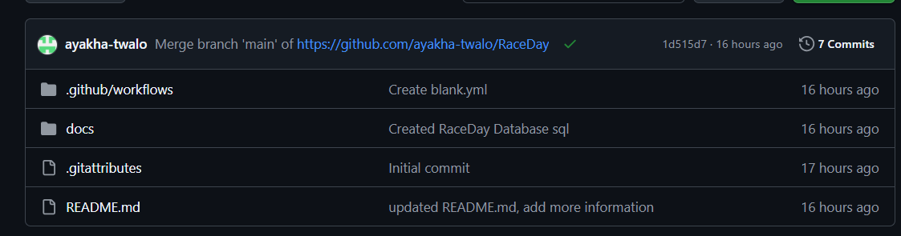

# PROG6212 — Programming 2B

## Student Information

**Name and Surname:** Ayakha Twalo  
**Student Number:** ST10490430  
**Module:** Programming 2B  
**Project:** RaceDay Event Management System  

---

# RaceDay Event Management System

## Project Overview

RaceDay is an event management system designed to make it easier for
Organisers to create and manage events while allowing Participants to browse
events, enrol in events and view their results.

The system is being planned as a web-based application with a relational
database and a REST API.

Part 1 focuses on planning and designing the system before development begins
in Part 2 and Part 3.

The main areas planned for the RaceDay system are:

- User registration and login
- User profile management
- Event management
- Event categories
- Participant enrolments
- Race results
- Role-based access for Organisers and Participants

## User Roles

### Organiser

Organisers are responsible for managing RaceDay events.

An Organiser will be able to:

- Create new events
- View events
- Update existing events
- Delete events
- Create categories for events
- View enrolments for their events
- Capture Participant results
- Manage event information

Organisers have access to management functions that are not available to
Participants.


### Participant

Participants use RaceDay to find and take part in events.

A Participant will be able to:

- Register for a RaceDay account
- Log in to the system
- View and update their own profile
- Browse available events
- View event details
- View event categories
- Enrol in an event
- Select a category when enrolling
- View their own enrolments
- View their own race results

Participants do not have access to Organiser-only management functions.


## Part 1

Part 1 focuses on planning the RaceDay system and creating the database
structure that will support the later development of the application.

The three main technical deliverables are:

### ERD

The Entity Relationship Diagram shows the data that will be stored by the
RaceDay system and how the entities are related.

The ERD contains the following entities:

- User
- Event
- EventType
- Category
- Enrolment
- EnrolmentStatus
- Result

The ERD identifies primary keys, foreign keys, relationships and cardinality.

The completed ERD is available in the `/docs` folder as:

`RaceDay_ERD.png`


### API Endpoint Plan

The API Endpoint Plan describes the REST API that will be developed in a
later part of the project.

The plan covers:

- Authentication
- User Profile
- Events
- Categories
- Event Enrolments
- Results

Each endpoint is documented using:

- HTTP Method
- Route
- Description
- Role Required
- Request Body
- Expected Response

The completed API Endpoint Plan is available in the `/docs` folder as:

`RaceDay_API_Endpoint_Plan.pdf`


### SQL Database Script

The SQL Database Script implements the database design from the ERD using
Microsoft SQL Server.

The database contains the following tables:

- Users
- EventTypes
- Events
- Categories
- EnrolmentStatuses
- Enrolments
- Results

The database includes:

- Primary keys
- Foreign keys
- NOT NULL constraints
- UNIQUE constraints
- CHECK constraints
- Default values
- Sample data
- Relationship testing queries

The SQL script was tested using SQL Server Management Studio (SSMS) and
executes successfully.

The completed SQL script is available in the `/docs` folder as:

`RaceDayDB.sql`

## Database Setup

To run the RaceDay database, open the SQL script from the `/docs` folder in
SQL Server Management Studio (SSMS) and execute the script.

The script creates and populates the RaceDay database.

## CI/CD

GitHub Actions is used to check that the required Part 1 files are present
in the repository.

### Successful Build


## Video Demonstration

YouTube Link: https://youtu.be/HMXjDea5D2A

## Repository Structure
```text

The repository is organised so that the Part 1 planning documents are kept
together in the `/docs` folder.

The planned repository structure is:


RaceDay
│
├── .github
│   └── workflows
│       └── part1-ci.yml
│
├── docs
│   ├── RaceDay_ERD.png
│   ├── RaceDay_API_Endpoint_Plan.pdf
│   └── RaceDayDB.sql
│
└── README.md
 

```

# Part 2 — RESTful API Implementation

Part 2 develops the RaceDay backend as an ASP.NET Core RESTful Web API. It builds on the planning and database design from Part 1 and implements functionality for authentication, profiles, events, categories, enrolments and results.

## Technologies Used

- **C# and .NET 8** — API implementation
- **ASP.NET Core Web API** — REST endpoints and controllers
- **Microsoft SQL Server / LocalDB** — relational data storage for local development
- **Entity Framework Core** — Code First data access and migrations
- **Swagger / Swashbuckle** — interactive API documentation and testing
- **xUnit** — automated tests
- **Git and GitHub** — source control and repository hosting
- **GitHub Actions** — automated build and test workflow

## Part 2 Project Structure

```text
RaceDay/
├── .github/
│   └── workflows/
│       └── blank.yml
├── docs/
│   ├── RaceDay_ERD.png
│   ├── RaceDay_API Endpoint Plan.pdf
│   └── RaceDay_Database.sql
├── RaceDay.Api/
│   ├── Controllers/
│   ├── Data/
│   ├── Migrations/
│   ├── Models/
│   ├── Program.cs
│   └── appsettings.json
├── RaceDay.Api.Tests/
├── RaceDay.Contracts/
├── RaceDay.slnx
├── CI_workflow.png
└── README.md
```

The main projects are:

- **RaceDay.Api:** Contains the API controllers, entity models, database context, migrations, configuration and application startup code.
- **RaceDay.Contracts:** Holds data transfer objects (DTOs) used to structure API requests and responses.
- **RaceDay.Api.Tests:** Contains the automated xUnit tests.
- **docs:** Holds the planning and database documents from Part 1.
- **.github/workflows:** Contains the GitHub Actions workflow.

## Database Configuration and Setup

The API uses Entity Framework Core with Microsoft SQL Server. The default connection string in `RaceDay.Api/appsettings.json` is configured for SQL Server LocalDB and a database named `RaceDayDb`.

```json
"DefaultConnection": "Server=(localdb)\\MSSQLLocalDB;Database=RaceDayDb;Trusted_Connection=True;MultipleActiveResultSets=true;TrustServerCertificate=True"
```

To set up the Part 2 database locally:

1. Install the .NET 8 SDK and ensure SQL Server LocalDB is available, or update the connection string to use your SQL Server instance.
2. Open the `RaceDay.slnx` solution in Visual Studio.
3. Confirm that the `DefaultConnection` setting in `RaceDay.Api/appsettings.json` matches your SQL Server setup.
4. From the repository root, apply the existing Entity Framework Core migrations:

   ```bash
   dotnet tool install --global dotnet-ef
   dotnet ef database update --project RaceDay.Api --startup-project RaceDay.Api
   ```

   If `dotnet-ef` is already installed, the installation command can be skipped.

The Part 1 SQL script in `docs/` documents the planned relational database. The Part 2 API uses its Entity Framework Core migrations to create or update the database used by the application.

## How to Run the API

From the repository root, restore the packages, build the solution and run the API:

```bash
dotnet restore
dotnet build
dotnet run --project RaceDay.Api
```

Use the local address shown in the terminal when the API starts. In the Development environment, Swagger UI is available at `/swagger` on that address.

## Authentication and Session Handling

RaceDay supports user registration, login and logout. Passwords are stored as hashes rather than as plain-text passwords. After a successful login, the API uses a session cookie to identify the signed-in user on subsequent requests.

The system supports two roles: **Organiser** and **Participant**. Role-based access restrictions protect management operations so that users cannot perform actions that are not permitted for their role. The registration configuration includes an Organiser registration code; keep this code private and change any development value before using the application in a shared or production environment.

## API Endpoints

The main endpoint groups and routes are listed below. Swagger provides the request and response schemas and details for each operation when the API is running.

| Feature | Method | Route | Purpose |
|---|---|---|---|
| Authentication | POST | `/api/auth/register` | Register a user |
| Authentication | POST | `/api/auth/login` | Sign in and establish a session |
| Authentication | POST | `/api/auth/logout` | Sign out |
| Events | GET | `/api/events` | Browse events |
| Events | GET | `/api/events/mine` | View events managed by the signed-in Organiser |
| Events | GET | `/api/events/{id}` | View event details |
| Events | POST | `/api/events` | Create an event |
| Events | PUT | `/api/events/{id}` | Update an event |
| Events | DELETE | `/api/events/{id}` | Delete an event |
| Categories | GET | `/api/events/{eventId}/categories` | View categories for an event |
| Categories | POST | `/api/events/{eventId}/categories` | Create a category for an event |
| Categories | PUT | `/api/categories/{id}` | Update a category |
| Categories | DELETE | `/api/categories/{id}` | Delete a category |
| Enrolments | POST | `/api/enrolments` | Enrol in an event |
| Enrolments | GET | `/api/enrolments/me` | View the signed-in Participant's enrolments |
| Enrolments | GET | `/api/events/{eventId}/enrolments` | View enrolments for an event |
| Enrolments | PUT | `/api/enrolments/{id}/status` | Update an enrolment's status |
| Profile | GET | `/api/users/me` | View the signed-in user's profile |
| Profile | PUT | `/api/users/me` | Update the signed-in user's profile |
| Results | POST | `/api/enrolments/{enrolmentId}/result` | Record a result for an enrolment |
| Results | GET | `/api/results/me` | View the signed-in Participant's results |
| Results | GET | `/api/results/event/{eventId}` | View results for an event |

Access to protected operations depends on the signed-in user's role. Log in through `/api/auth/login` before testing endpoints that require an authenticated session.

## Swagger API Documentation

Swagger is configured for the RaceDay API. When the API is running in the Development environment, open `/swagger` on the local API address to review available endpoints, inspect request and response schemas, and send test requests.

## Automated Testing

The test project is `RaceDay.Api.Tests` and uses xUnit. **All 35 tests passed locally.** The tests help verify the API's expected behaviour and catch regressions when code changes.

To run the tests from the repository root, use:

```bash
dotnet test --configuration Release
```

## CI/CD — GitHub Actions

GitHub Actions automates checks on the repository. The workflow restores dependencies, builds the solution and runs the automated tests. The latest workflow has been confirmed successful, and all 35 tests also passed locally.

### Part 2 Successful GitHub Actions Screenshot


## Part 2 Video Presentation

Youtube Link: https://youtu.be/0Kd_hAd00N8

## GITHUB LINK 

https://github.com/ayakha-twalo/RaceDay