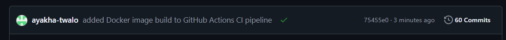

# PROG6212 — Programming 2B

## Student Information

- **Name:** Ayakha Twalo
- **Student Number:** ST10490430
- **Module:** Programming 2B
- **Module Code:** PROG6212
- **Project:** RaceDay Event Management System

---

# RaceDay Event Management System

## Project Overview

RaceDay is a web-based event management system. It allows Organisers to create and manage events, while Participants can browse events, enrol, manage their profiles and view their results.

The project is developed across three parts:

- **Part 1:** System planning, database design and API planning.
- **Part 2:** ASP.NET Core RESTful API, database access, authentication and automated tests.
- **Part 3:** ASP.NET Core MVC website, Azure Blob Storage integration and Docker deployment.

## User Roles

### Organiser

Organisers can:

- Register and log in.
- View their dashboard.
- Create, view, update and delete their events.
- Upload event banner images.
- Create and manage event categories.
- View participant enrolments and update enrolment statuses.
- Capture participant results, including finish times and positions.

### Participant

Participants can:

- Register and log in.
- View and update their profile.
- Upload or change their profile picture.
- Browse, search and filter events.
- View event details and categories.
- Enrol in events.
- View their own enrolments and enrolment statuses.
- View their race results.

Role-based access restricts Organiser management functions to Organisers.

---

# Part 1 — Planning and Database Design

Part 1 focused on planning the RaceDay system and preparing the database design and API documentation for development.

## Entity Relationship Diagram (ERD)

The ERD shows the main entities, keys and relationships used by the system. It includes:

- User
- Event
- EventType
- Category
- Enrolment
- EnrolmentStatus
- Result

The completed diagram is available in the `docs` folder as `RaceDay_ERD.png`.

## API Endpoint Plan

The API Endpoint Plan documents the planned REST API routes, HTTP methods, descriptions, roles, request bodies and expected responses. It covers authentication, user profiles, events, categories, enrolments and results.

The document is available in the `docs` folder as `RaceDay_API_Endpoint_Plan.pdf`.

## SQL Database Script

The SQL database script implements the planned relational database in Microsoft SQL Server. It includes tables, primary and foreign keys, constraints, default values, sample data and relationship-testing queries.

The script is available in the `docs` folder as `RaceDayDB.sql` and was tested using SQL Server Management Studio (SSMS).

---

# Part 2 — RESTful API Implementation

Part 2 developed the RaceDay backend as an ASP.NET Core RESTful Web API. The API handles authentication, user profiles, events, categories, enrolments and results.

## Technologies Used

- C# and .NET 8
- ASP.NET Core Web API
- Microsoft SQL Server / LocalDB
- Entity Framework Core and migrations
- Swagger / Swashbuckle
- xUnit
- Git and GitHub
- GitHub Actions

## Solution Structure

The solution contains the following main projects:

- **`RaceDay.Api`** — API controllers, models, database context, migrations, configuration and application startup.
- **`RaceDay.Contracts`** — data transfer objects (DTOs) used for API requests and responses.
- **`RaceDay.Api.Tests`** — automated xUnit tests.
- **`.github/workflows`** — GitHub Actions workflow configuration.

The solution file is `RaceDay.slnx`.

## Database Configuration

The API uses Entity Framework Core with Microsoft SQL Server. The default local development connection string is configured in `RaceDay.Api/appsettings.json` and uses a database named `RaceDayDb`.

To prepare the database locally:

1. Install the .NET 8 SDK and make sure SQL Server LocalDB or another supported SQL Server instance is available.
2. Open `RaceDay.slnx` in Visual Studio.
3. Check that the `DefaultConnection` setting in `RaceDay.Api/appsettings.json` matches your SQL Server setup.
4. From the repository root, apply the Entity Framework Core migrations:

```bash
dotnet tool install --global dotnet-ef
dotnet ef database update --project RaceDay.Api --startup-project RaceDay.Api
```

If `dotnet-ef` is already installed, the installation command can be skipped.

## Running the API

From the repository root:

```bash
dotnet restore
dotnet build
dotnet run --project RaceDay.Api
```

When running in the Development environment, Swagger UI is available at `/swagger` on the API's local address.

## Authentication and Authorisation

RaceDay supports user registration, login and logout. Passwords are stored as hashes, not plain text. The API uses a session cookie to identify the signed-in user on subsequent requests.

The system has two roles: **Organiser** and **Participant**. Protected operations check the user's role before allowing access. The Organiser registration code is configuration data and should be kept private.

## Main API Endpoint Groups

The API includes endpoint groups for:

- Authentication and session handling.
- User profile retrieval and updates.
- Event creation, retrieval, updating and deletion.
- Event category management.
- Participant enrolments and enrolment status updates.
- Participant and event results.

The API's Swagger documentation provides the available routes and request/response details when the API is running in Development.

## Automated Tests

The `RaceDay.Api.Tests` project uses xUnit. **All 35 API tests passed locally** during development.

Run the tests from the repository root with:

```bash
dotnet test --configuration Release
```

## Part 2 GitHub Actions Evidence

GitHub Actions restores dependencies, builds the solution and runs the automated tests.

Screenshot: `CI_workflow2-1.png`


## Part 2 Video Presentation

YouTube: https://youtu.be/0Kd_hAd00N8

---

# Part 3 — MVC Website, Azure Blob Storage and Docker

Part 3 adds an ASP.NET Core MVC website that communicates with the existing Part 2 REST API. The MVC application provides the user interface for Organisers and Participants.

## Technologies Used

- C# and .NET 8
- ASP.NET Core MVC
- Razor Views
- Bootstrap and CSS
- Azure Blob Storage
- Docker
- GitHub Actions

## MVC Website Features

### Organiser Features

- Organiser dashboard.
- Create, view, edit and delete events.
- Upload event banner images.
- Manage event categories.
- View participant enrolments.
- Update enrolment statuses.
- Record participant results.

### Participant Features

- Participant dashboard.
- Browse, search and filter events.
- View event details and categories.
- Enrol in events.
- View personal enrolments and their statuses.
- View personal race results.
- Update personal details.
- Upload and change a profile picture.

## Application Architecture

The MVC website communicates with the Part 2 REST API through its API client. The MVC project does not connect directly to the database and does not upload files directly to Azure.

The API remains responsible for application data and business operations. It also handles image uploads to Azure Blob Storage.

## Azure Blob Storage

Azure Blob Storage stores the images used by RaceDay. Two containers are configured:

- `event-banners` — event banner images.
- `profile-pictures` — Participant profile pictures.

The MVC application sends image files to the API. The API's `BlobStorageService` uploads the files to the relevant Azure container and saves the returned image URL with the related record.

The storage connection string is kept in **User Secrets** for local development. It must not be committed to GitHub or included in this README. The API must run in the Development environment when relying on Development User Secrets.

## Docker

The MVC application includes a `Dockerfile` at `RaceDay.Mvc/Dockerfile`. The root `.dockerignore` file excludes build output and other unnecessary files from the Docker build context.

The Docker image is built from the repository root.

### Build the Docker image

```bash
docker build -f RaceDay.Mvc/Dockerfile -t raceday-mvc:latest .
```

### Run the Docker container

The API must already be running and accessible to the container. For the local setup used during development, the API listens on port `5279` and the MVC website is exposed on port `8080`.

```bash
docker run -d --name raceday-mvc -p 8080:8080 -e "ApiSettings__BaseUrl=http://host.docker.internal:5279/" raceday-mvc:latest
```

Open the website in a browser at:

```text
http://localhost:8080
```

The `host.docker.internal` address allows the MVC container to reach the API running on the host computer. Keep the API running while using the Dockerised MVC website.

### Stop and remove the container

```bash
docker stop raceday-mvc
docker rm raceday-mvc
```

To use a newly built image, stop and remove the previous container, rebuild the image, and run the container again.

## Part 3 GitHub Actions — Continuous Integration

The `RaceDay CI` GitHub Actions workflow runs when changes are pushed to `main`, when a pull request targets `main`, or when the workflow is started manually.

The workflow:

1. Checks out the repository.
2. Sets up the .NET 8 SDK.
3. Restores the solution dependencies.
4. Builds the solution in Release configuration.
5. Runs the automated tests.
6. Builds the MVC Docker image.

The workflow completed successfully after the Docker image build step was added.

### Part 3 Successful GitHub Actions Screenshot



## Part 3 Video Presentation

YouTube demonstration link:
https://youtu.be/jS5YDoQPfRs

---

# Repository

GitHub repository: https://github.com/ayakha-twalo/RaceDay

## Main Repository Structure

```text
RaceDay/
├── .github/
│   └── workflows/
│       └── blank.yml
├── RaceDay.Api/
├── RaceDay.Api.Tests/
├── RaceDay.Contracts/
├── RaceDay.Mvc/
│   ├── Controllers/
│   ├── Services/
│   ├── Views/
│   ├── ViewModels/
│   └── Dockerfile
├── .dockerignore
├── .gitattributes
├── .gitignore
├── CI_workflow.png
├── CI_workflow2-1.png
├── CI_workflow3.png
├── RaceDay.slnx
└── README.md
```

The repository also contains the Part 1 planning and database documents in the `docs` folder.

---

# Final Notes

- Use the .NET 8 SDK to build and run the solution.
- Make sure the API is configured and running before using the MVC application.
- Configure the SQL Server connection string and Azure Blob Storage connection string in the appropriate local configuration or User Secrets.
- Do not commit passwords, connection strings, access keys or other secrets.
- The MVC Docker container needs a reachable API base URL to load and update RaceDay data.
